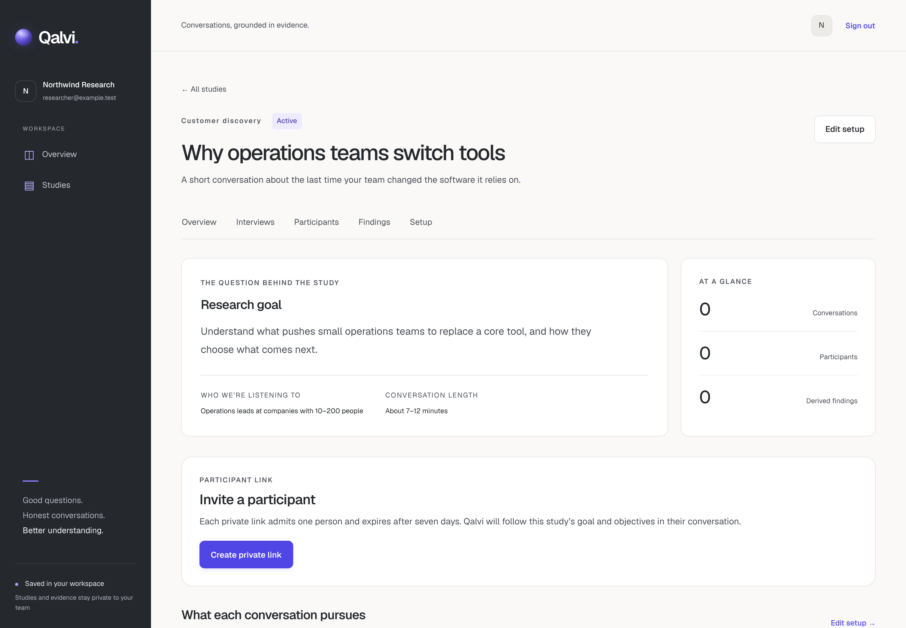
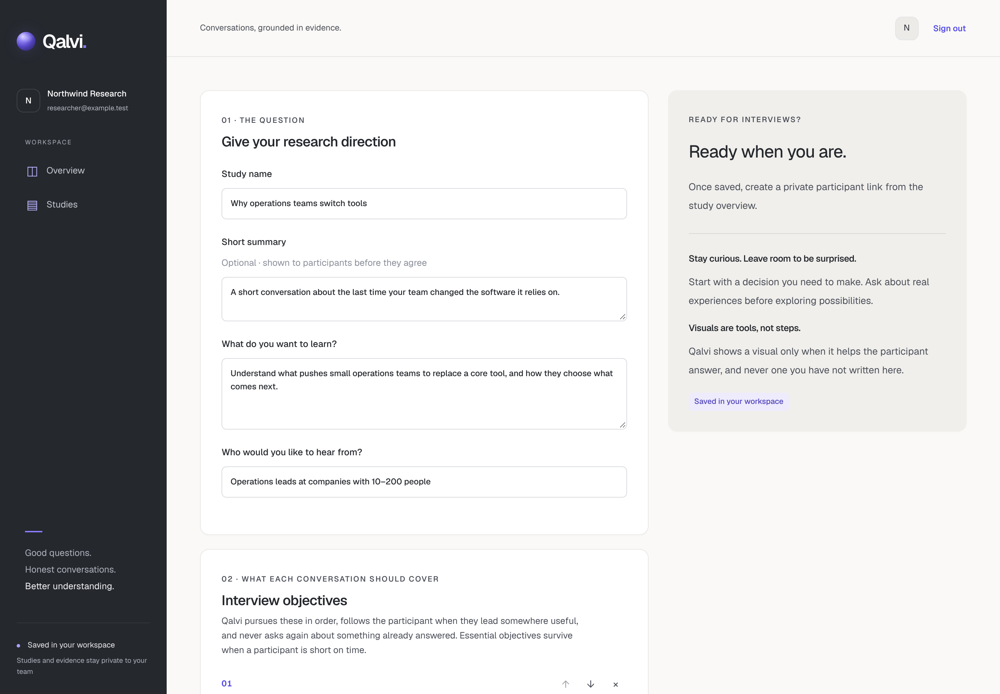
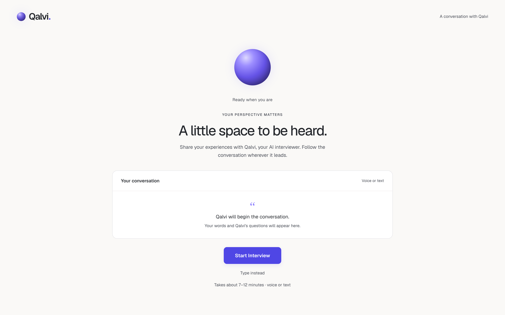
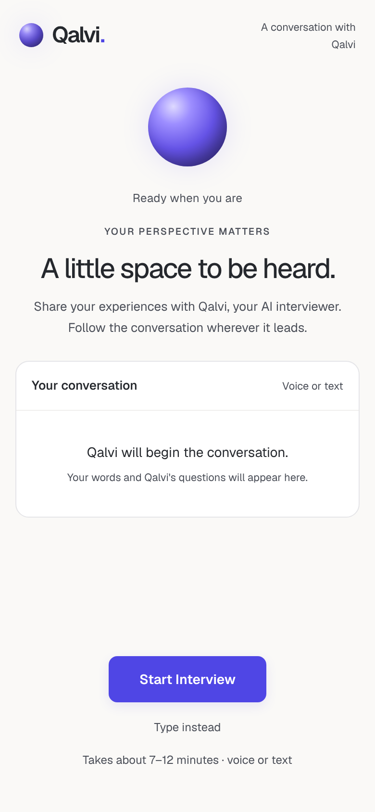
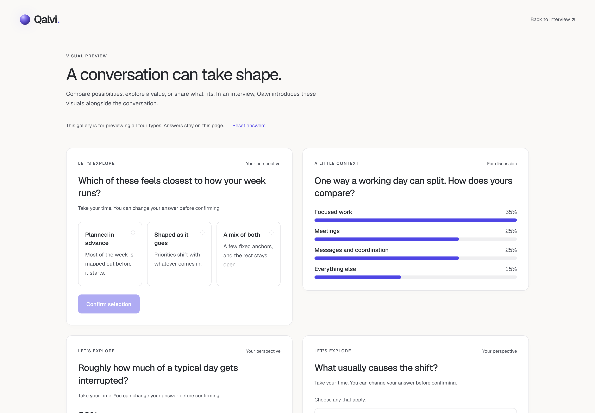

# Qalvi

Qalvi is an AI-powered conversation and research platform. A team defines a
study, shares a private participant link, and Qalvi's AI interviewer holds a
natural voice or text conversation that follows the study's goal and
objectives, adapting to what each person says.

It is built for founders, product teams, researchers, sales teams, agencies and
community teams doing customer discovery, PMF and product research, concept and
pricing tests, customer feedback and sales discovery. It is not a personal
assistant, a survey builder, or a recruitment/job-interview tool.

**Raw interview evidence is the source of truth.** Every participant and
interviewer message is stored as immutable, ordered evidence. Derived findings
must cite the messages that support them and never replace them:

`Study → Participant → Conversation → Raw Evidence → Derived Findings`

## What works today

- **Researcher workspace.** Sign in, then create and edit studies: research
  goal, who to interview, ordered objectives (essential or nice to have),
  assumptions to test, and an optional on-screen visual per objective using four
  predefined types: comparison cards, multiple choice, slider, bar chart.
  Studies are saved in Supabase under row level security, private to the
  workspace.
- **Participant links.** An active study issues private, single-use links that
  expire after seven days. The participant reads the study summary, explicitly
  consents to transcript storage, and joins. Audio is not stored.
- **Live interview.** A LiveKit room with a Python agent: Groq Whisper speech to
  text, a Groq-hosted LLM, Groq Orpheus speech, and the option to type or switch
  between voice and text at any time. The interview follows the saved study's
  goal and objectives, never a hard-coded study.
- **Conversational control.** Each turn is read into structured signals, and a
  deterministic conductor decides whether to probe, redirect, show a visual,
  skip, shorten or close. Concerns come first, covered topics are not asked
  again, and the interviewer stays neutral rather than selling the idea.
- **Durable evidence and recovery.** Each participant turn is committed to the
  database, with a control decision, before Qalvi replies. A browser refresh
  reconnects to the same conversation, and the server can move a session to a
  backup LiveKit project before the interview starts.
- **Demo.** `/interview/demo` runs a public, unsaved demo conversation with all
  four interactive visuals. `/interview/demo/visuals` previews the visuals
  without a session.

Study results (transcript review, findings, objective coverage) are the next
milestone. See [docs/ROADMAP.md](docs/ROADMAP.md) for status and scope.

## Stack

| Layer | Technology |
| --- | --- |
| Web app and server | Next.js 16 (App Router), React 19, TypeScript |
| Styling | Tailwind CSS 4 plus scoped CSS, local Geist fonts |
| Database and auth | Supabase (PostgreSQL, Auth, row level security), SQL migrations |
| Realtime voice | LiveKit (Cloud or self-hosted), `livekit-client`, `livekit-server-sdk` |
| Interview agent | Python, LiveKit Agents 1.8 |
| AI provider | Groq: `whisper-large-v3-turbo`, `openai/gpt-oss-120b`, `canopylabs/orpheus-v1-english` |
| Tests | Node test runner with PGlite (real migrations, no Docker), Python `unittest` |
| Package manager | npm |

## Repository layout

```
src/app/(research)/   researcher workspace: dashboard, studies, study workspace
src/app/interview/    participant routes: invitation, session, demo, gateway APIs
src/components/       researcher UI, interview room, predefined visuals
src/lib/studies/      study setup validator, RLS queries, save action
src/lib/interview/    invitation/session gateway and LiveKit routing (server-only)
agent/                Python interview agent (conductor, signals, study plan, persistence)
supabase/migrations/  schema, integrity rules, RLS policies, interview RPCs
tests/                Node tests, including database/RLS tests on PGlite
docs/                 product, architecture, interview engine, roadmap, decisions
```

## Run it locally

Requirements: Node.js 20 or later, npm, Python 3.11 or later for the agent, a
Supabase project, a LiveKit project, and a Groq API key.

1. **Install and configure the web app.**

   ```bash
   npm install
   cp .env.example .env.local
   ```

   Fill in `.env.local` with your LiveKit URL, key and secret and your Supabase
   URL, publishable key and secret key. The secret keys are read only by
   server code and are never sent to the browser.

2. **Apply the database migrations** to your Supabase project with the
   Supabase CLI:

   ```bash
   npx supabase link --project-ref <your-project-ref>
   npx supabase db push
   ```

3. **Start the web app.**

   ```bash
   npm run dev
   ```

   Open http://localhost:3000, sign in with a Supabase Auth user, and your
   first workspace is created on first sign-in.

4. **Run the interview agent** in a second terminal:

   ```bash
   cd agent
   python -m venv .venv
   source .venv/bin/activate        # Windows: .venv\Scripts\activate
   pip install -r requirements.txt
   cp .env.example .env             # LiveKit, Groq, and the agent's Supabase secret key
   python main.py dev
   ```

   For production the agent runs on LiveKit Cloud; see
   [agent/README.md](agent/README.md).

5. **Try it.** Create a study, add a goal, an audience and at least one
   objective, set it to Active, then create a private link from the study
   overview and open it in another browser.

### Checks

```bash
npm run build        # production build (also generates Next.js route types)
npx tsc --noEmit     # TypeScript
npm run lint         # ESLint
npm test             # Node tests, including database and RLS tests
cd agent && python -m unittest discover -p "test_*.py"   # agent tests
```

## Screenshots

Study overview, with the research goal, objectives and a participant link:



Study setup: goal, audience, objectives with optional visuals, assumptions:



The participant room, on desktop and mobile:





The four predefined interactive visuals:



The researcher screenshots use illustrative study content. No real participant
data appears in this repository.

## Principles

- AI reasons, application code calculates, React renders, the database
  remembers. The AI never generates executable frontend code during interviews;
  visuals are predefined components fed with validated data.
- Secrets stay server-side. Participants never sign in and are stored only as
  pseudonymous aliases.
- Qalvi is generic. Every study, including the first pilot, is configured
  through the same study system.

Read [AGENTS.md](AGENTS.md) and the documents in [docs/](docs) before changing
code or architecture.
