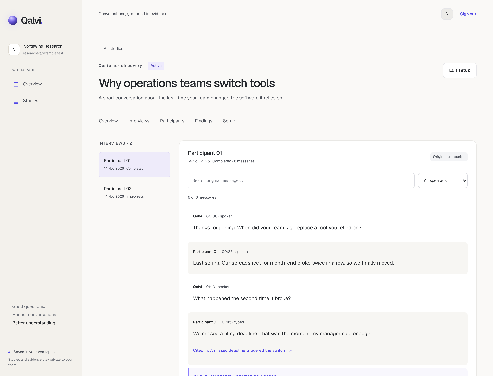
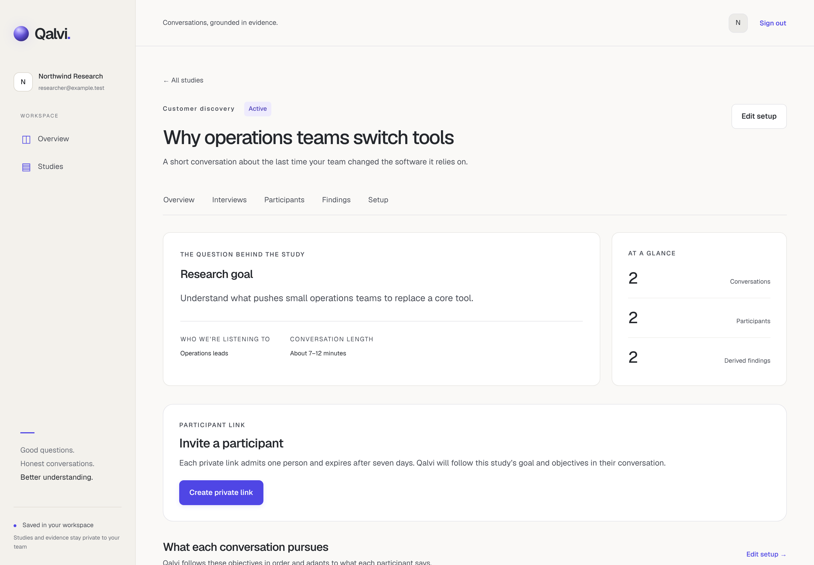
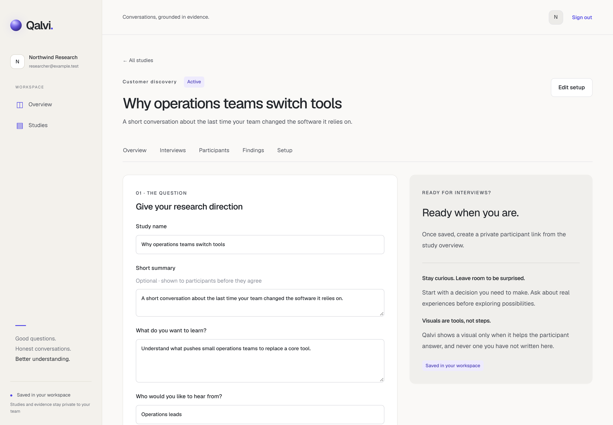
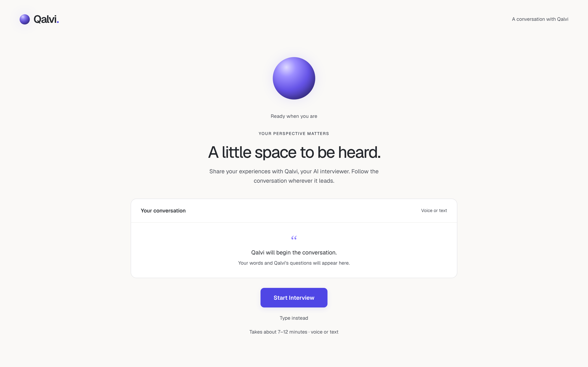
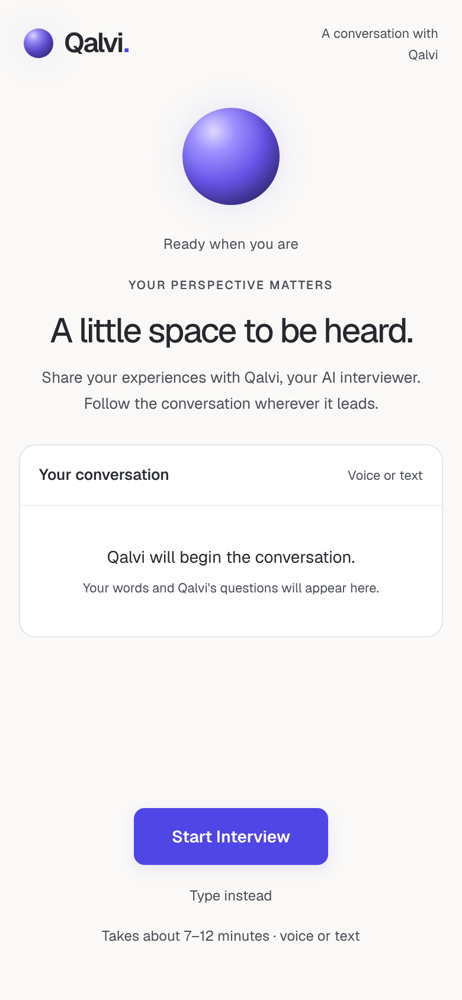
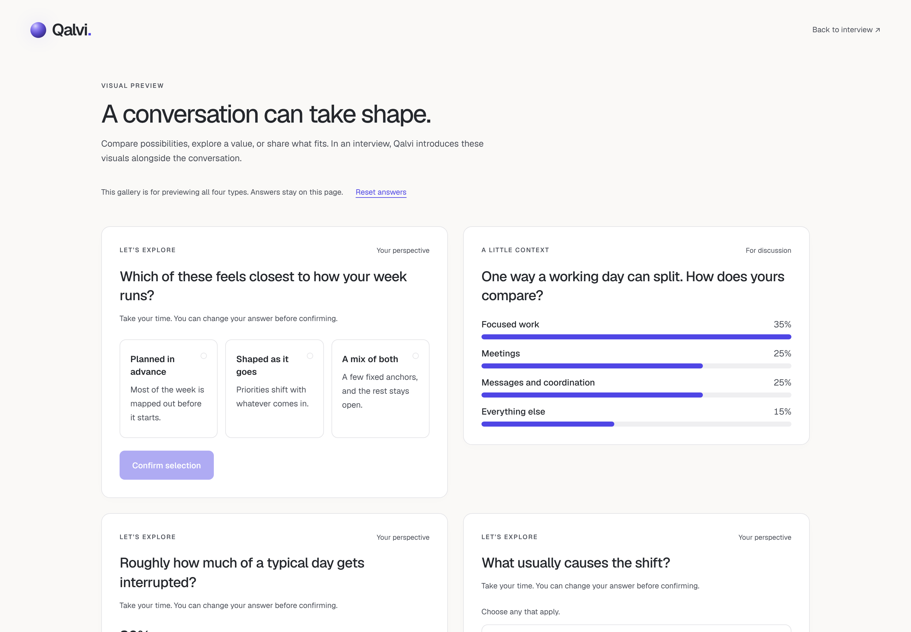

# Qalvi

Qalvi is an AI-powered conversation and research platform. A team defines a
study, shares a private participant link, and Qalvi's AI interviewer holds a
natural voice or text conversation that follows the study's goal and
objectives, adapting to what each person says.

It is built for founders, product teams, researchers, sales teams, agencies and
community teams doing customer discovery, PMF and product research, concept and
pricing tests, customer feedback and sales discovery. It is not a personal
assistant, a survey builder, or a recruitment/job-interview tool.

**Raw interview evidence is the source of truth.** Every participant and
interviewer message is stored as immutable, ordered evidence. Derived findings
must cite the messages that support them and never replace them:

`Study → Participant → Conversation → Raw Evidence → Derived Findings`

## What it does

- **Study setup.** A signed-in researcher creates and edits studies: research
  goal, who to interview, ordered objectives (essential or nice to have),
  assumptions to test, and an optional on-screen visual per objective from four
  predefined types: comparison cards, multiple choice, slider, bar chart.
- **Participant links.** An active study issues private, single-use links that
  expire after seven days. The participant reads the study summary, consents to
  transcript storage, and joins without an account. Audio is not stored.
- **Live interview.** Voice or text in one conversation, switchable at any time.
  The interviewer follows the saved study's goal and objectives. Each turn is
  read into structured signals and a deterministic conductor decides whether to
  probe, redirect, show a visual, skip, shorten or close.
- **Visual evidence.** A visual is recorded before it is shown. A tapped answer
  is rebuilt by the agent from the visual it displayed and stored atomically as
  a transcript message plus a structured response.
- **Recovery and lifecycle.** Every participant turn and its control decision
  are committed before Qalvi replies. A refresh rejoins the same conversation, a
  replacement worker replays saved decisions without repeating itself, and
  completion, cancellation and participant ejection are durable.
- **Results.** Researchers read original transcripts with search and speaker
  filters, see what was shown on screen, and can request an analysis: a summary,
  objective coverage and proposed findings. Every finding links to the exact
  messages it rests on, including evidence against it, and stays a proposal
  until a researcher accepts it.
- **Demo.** `/interview/demo` runs a public, unsaved demo conversation.

## Architecture

```
Researcher browser ── Next.js (Vercel) ── Supabase Postgres + Auth (RLS)
                          │    ▲
Participant browser ──────┘    │ service-only RPCs
        │                      │
        └── LiveKit Cloud ── Python agent (Groq STT, LLM, TTS)
```

- The **web app** owns researcher pages, the participant gateway (invitation,
  consent, resume cookie, LiveKit token) and results. It never runs the agent.
- The **agent** runs on LiveKit Cloud. It resolves its room to one consented
  conversation, claims a fenced writer lease, reads that conversation's study
  plan from the database, and is the only writer of interview evidence.
- The **database** enforces the rules that matter: immutable messages, ordered
  idempotent appends, answers that must match what was shown, findings that must
  cite evidence, and tenancy through composite keys and row level security.

### Design decisions

- AI reasons, application code calculates, React renders, the database
  remembers. The model never authors a visual or executable code.
- Derived data is kept apart from evidence. An analysis can fail or be re-run
  without touching a transcript, and the UI shows cited messages themselves
  rather than model-written quotes.
- Control decisions are deterministic and versioned, so a replacement worker can
  replay an interview from saved state instead of guessing.
- Qalvi is generic. Every study, including the first pilot, is configured
  through the same study system.

### Security boundaries

- Researchers act only through their own RLS session. Another workspace's
  studies, interviews and findings do not appear.
- Participants never sign in and are stored as pseudonymous aliases. Invitation
  and resume capabilities are opaque tokens stored only as hashes.
- The browser never chooses a room, identity, study or tenant, and never writes
  evidence. Privileged operations are service-role RPCs called by server code.
- Secrets (Supabase secret key, LiveKit secrets, Groq key, scheduler secrets)
  are server-only and never use a `NEXT_PUBLIC_` name.

See [docs/ROADMAP.md](docs/ROADMAP.md) for status and
[docs/ARCHITECTURE.md](docs/ARCHITECTURE.md) for detail.

## Stack

| Layer | Technology |
| --- | --- |
| Web app and server | Next.js 16 (App Router), React 19, TypeScript |
| Styling | Tailwind CSS 4 plus scoped CSS, local Geist fonts |
| Database and auth | Supabase (PostgreSQL, Auth, row level security), SQL migrations |
| Realtime voice | LiveKit (Cloud or self-hosted), `livekit-client`, `livekit-server-sdk` |
| Interview agent | Python, LiveKit Agents 1.8 |
| AI provider | Groq: `whisper-large-v3-turbo`, `openai/gpt-oss-120b`, `canopylabs/orpheus-v1-english` |
| Tests | Node test runner with PGlite (real migrations, no Docker), Python `unittest` |
| Package manager | npm |

## Repository layout

```
src/app/(research)/   researcher workspace: dashboard, studies, study workspace
src/app/interview/    participant routes: invitation, session, demo, gateway APIs
src/components/       researcher UI, interview room, predefined visuals
src/lib/studies/      study setup validator, RLS queries, save action
src/lib/interview/    invitation/session gateway and LiveKit routing (server-only)
agent/                Python interview agent (conductor, signals, study plan, persistence)
supabase/migrations/  schema, integrity rules, RLS policies, interview RPCs
tests/                Node tests, including database/RLS tests on PGlite
docs/                 product, architecture, interview engine, roadmap, decisions
```

## Run it locally

Requirements: Node.js 20 or later, npm, Python 3.11 or later for the agent, a
Supabase project, a LiveKit project, and a Groq API key.

1. **Install and configure the web app.**

   ```bash
   npm install
   cp .env.example .env.local
   ```

   Fill in `.env.local` with your LiveKit URL, key and secret and your Supabase
   URL, publishable key and secret key. The secret keys are read only by
   server code and are never sent to the browser.

2. **Apply the database migrations** to your Supabase project with the
   Supabase CLI:

   ```bash
   npx supabase link --project-ref <your-project-ref>
   npx supabase db push
   ```

3. **Start the web app.**

   ```bash
   npm run dev
   ```

   Open http://localhost:3000, sign in with a Supabase Auth user, and your
   first workspace is created on first sign-in.

4. **Run the interview agent** in a second terminal:

   ```bash
   cd agent
   python -m venv .venv
   source .venv/bin/activate        # Windows: .venv\Scripts\activate
   pip install -r requirements.txt
   cp .env.example .env             # LiveKit, Groq, and the agent's Supabase secret key
   python main.py dev
   ```

   For production the agent runs on LiveKit Cloud; see
   [agent/README.md](agent/README.md).

5. **Try it.** Create a study, add a goal, an audience and at least one
   objective, set it to Active, then create a private link from the study
   overview and open it in another browser.

### Checks

```bash
npm run build        # production build (also generates Next.js route types)
npx tsc --noEmit     # TypeScript
npm run lint         # ESLint
npm test             # Node tests, including database and RLS tests
cd agent && python -m unittest discover -p "test_*.py"   # agent tests
```

## Deployment

- **Web app:** Vercel, from this repository. Set the variables in
  `.env.example` for Production and Preview. `vercel.json` registers a daily
  cron that drains the interview lifecycle outbox through an authenticated GET.
- **Agent:** LiveKit Cloud, one named worker per LiveKit project (see
  [agent/README.md](agent/README.md)). It is a long-lived process and does not
  run on Vercel.
- **Database:** apply `supabase/migrations` in order with the Supabase CLI.

Live demo: see the repository description for the current Vercel URL.

## Screenshots

Interview results: the original transcript, what was shown on screen, and the
AI interpretation kept separate below it.



Study overview with objectives and a participant link:



Study setup:



The participant room, on desktop and mobile:





The four predefined interactive visuals:



Researcher screenshots use illustrative content. No real participant data
appears in this repository.

## Known limitations

- A human microphone session in a normal browser and a spoken-turn worker
  replacement are still pending acceptance. Automated and synthetic-audio runs
  do not replace them.
- An interview follows the study as saved when it starts. Editing objectives
  during a live interview makes a later worker replacement fail closed.
- Analysis runs when a researcher asks for it, one interview at a time. There
  is no cross-interview synthesis yet.
- No per-study time budget, team management, billing or recruitment.
- The Vercel cron is daily, which suits every plan. Ejection retries also run
  whenever an interview ends; a tighter schedule needs a paid plan or another
  scheduler.

## Principles

- AI reasons, application code calculates, React renders, the database
  remembers. The AI never generates executable frontend code during interviews;
  visuals are predefined components fed with validated data.
- Secrets stay server-side. Participants never sign in and are stored only as
  pseudonymous aliases.
- Qalvi is generic. Every study, including the first pilot, is configured
  through the same study system.

Read [AGENTS.md](AGENTS.md) and the documents in [docs/](docs) before changing
code or architecture.
